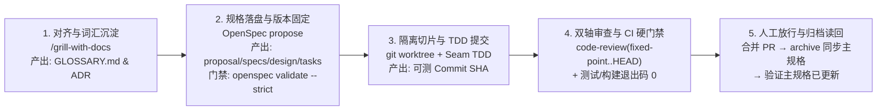

# 企业代码开发最佳实践与落地蓝图

**结论先行（BLUF）**：当前企业级 AI 代码开发的成熟实践，正在从「调教更好的 Prompt」收敛为 **SDD（Spec-Driven Development，规格驱动开发）+ Harness Engineering（确定性工程护栏）**。企业不应把质量完全押注在单一工具或 Agent 的「自觉性」上，而应采用**「人类掌控需求与架构边界 + 宪法与 Delta Spec 管住组织红线与存量真源 + 自动化测试与受保护分支 CI 锁死交付门禁」**的分层体系。

## 先决条件

- 已阅读前两篇：[深度对比](./tools-comparison) 与 [SDD 质量保证机制](./sdd-quality-assurance)。
- 团队已具备基础的 Git 受保护分支（Protected Branch）、CI/CD 流水线与自动化测试运行环境。

## 学习目标

读完本文，你将能够：
1. 掌握 AI 时代代码开发的 **6 大核心工程支柱** 及其不可逾越的反模式（NEVER）。
2. 根据**变更风险与组织协作形态**（而非单纯按人数）选择匹配的 SDD 组合方案。
3. 直接复现一条**从固定规格到 CI 门禁合并**的最小单仓试点流水线。

---

## 一、目前代码开发最佳实践的 6 大核心支柱

综合 `obra/superpowers`、`Fission-AI/OpenSpec`、`github/spec-kit` 与 `mattpocock/skills` 的核心机制，高可靠 AI 研发体系建立在以下六根支柱之上：

| 支柱 | 核心原则 | 反模式（NEVER） | 可落地的最小实践 |
| --- | --- | --- | --- |
| **1. Spec-First 与增量真源** | 先定行为契约再写代码；存量项目用 Delta Spec 持续同步主规格 | **NEVER** 需求模糊时让 AI 直接改代码；**NEVER** 让文档与代码长期双轨脱节 | 用 `OpenSpec` 管理变更提案与增量规格，合入后同步归档 |
| **2. 通用语言与宪法/ADR 护栏** | 团队与 AI 共享同一套领域词表与不可协商底线 | **NEVER** 让 AI 凭猜测发明同义变量名，或每次会话推翻既有架构红线 | 维护 `GLOSSARY.md`（术语表）、`docs/adr/` 与 `.specify/memory/constitution.md` |
| **3. 垂直示踪弹切片与隔离** | 按「端到端可验证垂直切片（Tracer Bullet）」拆任务，隔离并发工作区 | **NEVER** 按技术层（全端 DTO→DAO→UI）水平切片；**NEVER** 多任务并发写同一工作目录 | 用任务依赖图（DAG）拆出带阻塞边的 Ticket，高并发时在独立 `git worktree` 执行 |
| **4. Seam 边界 TDD 与新鲜证据** | 在人类预确认的公共接口（Seam）做红-绿测试；无新鲜命令输出不宣称完工 | **NEVER** 写耦合内部私有方法的测试；**NEVER** 在未跑最新测试/构建时说「应该好了」 | 强制 `Red → Green` 循环，交付必须附带最新 Commit 上的命令退出码与输出 |
| **5. 双轴独立 Review 与定期熵减** | 「是否符合规范」与「是否满足 Spec」独立审查；周期性深化模块边界 | **NEVER** 用「代码格式漂亮」掩盖需求漏项；**NEVER** 放任 AI 堆砌浅层胶水代码 | 配置 `Standards` + `Spec` 双轴审查；按团队节奏（可选每周）运行架构巡检 |
| **6. Harness 自进化与 CI 硬门禁** | 把重复踩坑固化为 Linter/CI 脚本，区分「Agent 提示」与「分支硬门禁」 | **NEVER** 把一次性教训留在聊天记录里，或指望提示词替代 CI 拦截 | 任务后用 `retro` 提炼改进项；把静态校验、测试与例外审批接入 CI 合并门禁 |

---

## 二、分层落地路线：按风险等级与协作形态选型

企业落地切忌按人数拍脑袋，而应按**变更风险、跨仓依赖与合规要求**分层配置：

### 场景 A：低风险单仓 / 独立开发者与小团队
- **核心风险**：需求没想清就开写、测试耦合内部实现、代码两周后腐化为大泥球。
- **推荐组合**：`mattpocock/skills`（`/grill-with-docs` + `tdd` + `code-review`）+ `obra/superpowers` 质量铁律（`verification-before-completion`）。
- **落地重点**：
  1. 复杂改动前先跑 `/grill-with-docs` 对齐设计树并更新 `GLOSSARY.md`。
  2. 编码前先让人类确认测试 Seam，按垂直切片做红-绿测试。
  3. 仅在必要时（如长任务防压缩）引入磁盘进度账本。

### 场景 B：多人并发的存量业务单仓（Brownfield）
- **核心风险**：多人/多 Agent 并发修改同一存量仓库，彼此踩踏既有系统行为，或并发改同一份 Spec 产生冲突。
- **推荐组合**：`Fission-AI/OpenSpec`（单仓 Delta Spec）+ `obra/superpowers`（Worktree 隔离与账本）+ `mattpocock/skills`（`code-review` / `improve-codebase-architecture`）。
- **落地重点**：
  1. 并发修改同一规格时，必须明确**规格所有者（Owner）与版本基线**，并在集成后复核主规格一致性。
  2. 在 CI 中对在途变更运行 `openspec validate <change-id> --type change --strict --no-interactive`（或批量 `--changes --strict --no-interactive`），但**同时要求关联的自动化测试全部通过**。
  3. 定期（如双周或每周五，属团队可选策略）运行 `/improve-codebase-architecture` 清理浅层封装与重复逻辑。

### 场景 C：跨仓微服务 / 强合规与离线组织
- **核心风险**：外部 API/Schema 契约变更破坏下游、敏感或不可逆操作缺少审批、私有化/离线环境无法使用公网组件。
- **推荐组合**：`github/spec-kit`（`.specify/memory/constitution.md` + Preset/私有 Catalog）+ `Fission-AI/OpenSpec` Stores（beta）+ Issue Tracker DAG。
- **落地重点**：
  1. 用 `spec-kit` 的 **Preset / Private Catalog** 下发组织级宪法与合规检查清单。
  2. 对外部契约变更，额外补充**兼容性矩阵、部署顺序、回滚与数据迁移验收**；对敏感或不可逆变更，强制**人工审批记录与脱敏证据**。
  3. 若使用 OpenSpec **Stores（beta）**共享跨仓规格，需明确其仅提供只读 `references` 上下文，**不能替代 Git 同步、跨仓版本固定（Pinning）或联调集成验收**。

---

## 三、可复现试点：三工具单仓实战流水线

下面是一条可直接照搬的**「三工具单仓试点流水线（mattpocock/skills + OpenSpec + superpowers）」**，严格遵循**「固定规格版本 → 实施提交 → 对该提交审查与 CI → 获授权合并 → 归档并读回」**的不可逆顺序（若团队同时引入 `spec-kit`，可在阶段 1 之前叠加 `.specify/memory/constitution.md` 审查）：

### 最小试点执行清单（输入 → 产物 → 证据 → 人工接管点）

| 阶段 | 输入 | 核心产物 | 可验证证据 / 命令 | 人工接管点 |
| --- | --- | --- | --- | --- |
| **1. 对齐** | 原始业务需求 | `GLOSSARY.md`、ADR | 设计树无未决分支 | 确认 Non-Goals 与核心术语 |
| **2. 契约** | 对齐结论 | `openspec/changes/<id>/` 四件套 | `openspec validate <id> --type change --strict --no-interactive` 退出码 `0` | 审批 `proposal.md` 与测试 Seam（固定 Spec 版本） |
| **3. 实施** | 固定后的 Spec + `tasks.md` | 独立 Worktree 分支上的 Commit | 每个切片先红灯（预期行为失败）后绿灯；若遇无法保持绿灯的宽重构，采用 **Expand–Contract**（先扩展兼容→分批迁移→再收缩删旧） | 遇破坏性/安全边界决策时停下由人裁决 |
| **4. 审查与 CI** | `git diff <base>...HEAD` + 固定 Spec | 双轴 Review 报告（Standards + Spec） | CI 执行全量单测 + 构建退出码 `0`；核对 Review 未跳过 Spec 轴 | 人工复核双轴报告与合并风险（单向门 vs 双向门） |
| **5. 归档** | 已合并的主干代码 | 更新后的 `openspec/specs/` | 执行 `archive` 后读回 `openspec show <spec-id> --type spec` 确认主规格已同步 | 确认主规格与线上行为一致；运行 `/retro` 沉淀新规则 |

---

## 四、企业引入常见陷阱与护栏（Guardrails）

1. **NEVER 用重型流程覆盖微小型改动**：改一个文案或样式色值，直接修改并跑通验证即可；只有涉及跨模块、状态流转或存量行为变更时才走完整 SDD。
2. **NEVER 混淆「Agent 提示」与「CI 硬门禁」**：Agent 可能会因确认跳过 `archive` 中的未完成任务，或在 YAML 解析失败时跳过 Hook；所有阻断性质量红线必须配置在受保护分支的 CI 必过检查中，例外审批需单独留痕。
3. **NEVER 在未提交时跑基于 Commit Diff 的 Review**：`mattpocock/skills` 的 `code-review` 依赖 `git diff <fixed-point>...HEAD`，务必先形成完整 Commit 再触发审查，并核对 Spec 轴未被静默跳过。
4. **NEVER 忽视周期性架构熵减**：AI 极易快速堆出浅层封装与重复分支；若不定期做模块深化与坏味道清理，后续 Agent 的上下文检索与修改成本会持续攀升。

## 下一步

- 如果你想先评估团队采购与模型选型预算，可以结合阅读 [采购与实施方案](/zh/practice/procurement-plan) 与 [Vibe Coding 报告](/zh/practice/reporter)。
- 如果你准备在项目中启动最小试点：
  1. 在仓库初始化 `GLOSSARY.md` 与精简的 `AGENTS.md`；
  2. 选取一个低风险存量特性，按第三节表格跑通一次 `OpenSpec` 校验 + Seam TDD + CI 硬门禁闭环。
