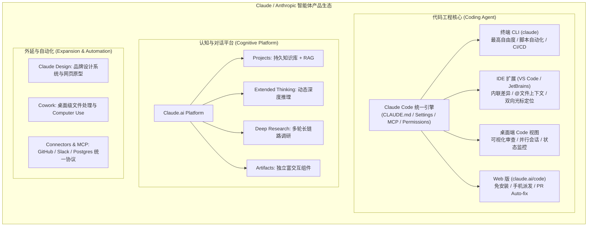
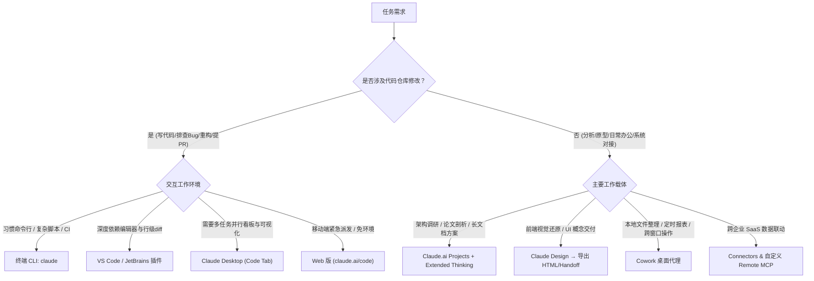
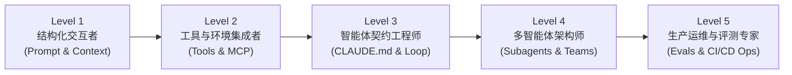

# Claude Code 与 Anthropic 智能体生态学习导航

> Claude Code 与 Anthropic 智能体生态是面向现代软件工程与自主智能体的完整技术栈，涵盖终端 CLI、IDE 插件、桌面端、云端 Web 及企业级连接器。本指南不仅是生态产品的全景地图，更系统融入了 **Anthropic 官方 22 门免费核心课程体系** 与 **Claude Code 官方架构工程实践**，为开发者提供从结构化提示词到工业级多代理协作的最短掌握路径。

---

## 1. 产品生态全景图

### 快速选型与决策矩阵

---

## 2. Anthropic 官方 22 门课程知识图谱映射

Anthropic 官方课程覆盖了从大模型底层感知到复杂企业级 Agent 生产落地的全生命周期。下表系统映射了这 22 门核心课程在 Claude 生态中的落地载体与实操指南：

| 模块阶段 | 课程名称 | 核心工程能力与掌握要点 | 落地工具与推荐阅读 |
|:---|:---|:---|:---|
| **Phase 1: 提示工程与结构化表达** | **1. Prompt Engineering 101** | 清晰指令、上下文分离、正向角色约束，告别泛化指令 | [Claude.ai 指南](./claude-ai) |
| | **2. Advanced Context Structuring** | 严谨运用 XML 标签（`<context>`, `<rules>`, `<diff>`）阻断幻觉 | [CLAUDE.md 最佳实践](./claude-code#项目上下文管理) |
| | **3. System Prompt Architecture** | 静态系统指令分层：身份、可用工具、边界红线、输出协议 | [Cheatsheet 配置](./claude-code-cheatsheet) |
| | **4. Few-shot & In-context Learning** | 结构化黄金范例注入，严格对齐复杂业务领域模型 | [Cookbook 开发手册](./claude-code-cookbook) |
| | **5. Chain of Thought (CoT)** | 显式推理链设计，将复杂计算与状态推演步骤化 | [Extended Thinking 章节](./claude-ai#extended-thinking-深度推理) |
| | **6. Extended Thinking 深度实操** | Claude 3.7 Sonnet 动态思维预算（Thinking Budget）控制与决策分离 | [模型深度推理](./claude-code#模型参考与思维控制) |
| **Phase 2: 工具调度与动态上下文** | **7. Tool Use (Function Calling) 基础** | JSON Schema 参数契约、模型调用意图解析、参数强校验 | [Claude Code 工具机制](./claude-code#工具调度机制) |
| | **8. Advanced Tool Chaining** | 多工具编排链路、错误自愈重试、状态保持与短路降级 | [实战工作流](./claude-code-cookbook#复杂多工具调试) |
| | **9. Dynamic Context Injection** | 运行时环境感知、按需文件索引提取，避免上下文污染 | [Context 诊断与优化](./claude-code#故障排除) |
| | **10. Prompt Injection & Tool Safety** | 间接提示词注入防御、只读/写权限安全隔离、用户审批闸门 | [安全与权限模型](./claude-code#权限与安全边界) |
| **Phase 3: 协议规范与环境接入** | **11. Model Context Protocol (MCP) 核心** | 开放三层架构：Host (Claude Code) ↔ Client ↔ Server | [MCP 协议指南](./claude-code#mcp-集成) |
| | **12. Building Custom MCP Servers** | 编写标准化 Resources、Tools 与 Prompts 服务端 | [Plugin 与 MCP 扩展](./plugin) |
| | **13. Enterprise Remote MCP & Auth** | 生产级 OAuth 鉴权、网关反向代理、内网微服务安全直连 | [Connectors 集成](./connectors) |
| | **14. Connectors 生态实操** | GitHub / Notion / Slack / Google Workspace 现成集成配置 | [Connectors 手册](./connectors) |
| **Phase 4: 自治智能体与代码协作** | **15. Claude Code Harness 架构原理** | 探索-计划-执行-验证（Loop: Read → Plan → Exec → Verify）闭环 | [Claude Code 深度指南](./claude-code) |
| | **16. Subagent 编排与上下文隔离** | Orchestrator-Worker 模式：子代理无干扰独立探索与结果汇总结算 | [Subagents 子代理指南](./claude-code#sub-agents-子代理) |
| | **17. Prompt Caching 性能与成本控制** | 90% 降本长文本缓存断点：前缀匹配、TTL 机制与 CLAUDE.md 布局优化 | [性能优化与缓存](./claude-code#prompt-caching-机制) |
| | **18. Context Compaction 自动压缩** | 会话超窗时的增量摘要、历史修剪与核心事实持久化提取 | [长会话治理](./claude-code#长会话与压缩管理) |
| | **19. CI/CD & Headless 自动化** | `--print` 无头流式批处理、代码审查门禁、自动修复 PR | [无头自动化指南](./claude-code#无头模式-headless) |
| **Phase 5: 多模态、评测与前沿演进** | **20. Computer Use 桌面视感交互** | 屏幕抓图、语义坐标定位、键鼠事件驱动与桌面沙箱限制 | [Cowork 计算机使用](./cowork#计算机使用-computer-use) |
| | **21. Model-Graded Evals 评测体系** | 基于真实业务数据集建立 LLM-as-a-Judge 评测套件，度量 Agent 成功率 | [Cookbook Evals 章节](./claude-code-cookbook#evals-与自动化验证) |
| | **22. Multi-Agent Systems & Alignment** | 多 Agent 协作对齐、对抗式验证（Adversarial Verification）与最终交付责任制 | [最佳实践模式](./claude-code#最佳实践) |

---

## 3. 五级能力进阶阶梯

### Level 1: 结构化交互者 (Prompt & Context)
- **目标**：彻底脱离“聊天式”模糊提问，掌握 XML 语义分隔与约束强化。
- **关键实践**：在任何交互中明确区分背景、任务、输入数据与格式要求；学会使用 Claude 3.7 的 Extended Thinking 解决高复杂度逻辑。
- **核心文档**：[Claude.ai 核心指南](./claude-ai)

### Level 2: 工具与环境集成者 (Tools & MCP)
- **目标**：打通模型与外部世界的通道，能够独立配置和开发 MCP 工具。
- **关键实践**：使用 `claude mcp add` 挂载数据库（PostgreSQL/SQLite）、代码检索和 API 工具；建立安全的本地权限白名单。
- **核心文档**：[MCP 集成指南](./claude-code#mcp-集成) · [Connectors 外部连接](./connectors)

### Level 3: 智能体契约工程师 (CLAUDE.md & Loop)
- **目标**：理解 Agent 的 Harness 执行环路，建立高确定性的仓库级持久化规则。
- **关键实践**：编写规范的 `CLAUDE.md`（包含极简构建命令、核心目录边界、代码规范）；熟悉 Claude Code 的审批阻断机制（Bypass/Approval）。
- **核心文档**：[Claude Code 核心教程](./claude-code) · [CLAUDE.md 最佳范例](./claude-code#项目上下文管理)

### Level 4: 多智能体架构师 (Subagents & Workflows)
- **目标**：解决单会话上下文爆炸难题，通过分层代理实现复杂项目并行推进。
- **关键实践**：使用子代理（Subagent）隔离海量文件只读调研，主代理仅吸收提炼后的结论；利用 Git Worktree 实现分支级完全隔离。
- **核心文档**：[Subagents 指南](./claude-code#sub-agents-子代理) · [实战 Cookbook](./claude-code-cookbook)

### Level 5: 生产运维与评测专家 (Evals & CI/CD Ops)
- **目标**：将 Claude Code 深度植入企业研发流水线，具备量化评测与质量监控能力。
- **关键实践**：在 GitHub Actions / GitLab CI 中使用 `--print` 模式自动修复 PR；构建 Golden Dataset 与断言门禁，度量自动化任务通过率。
- **核心文档**：[无头模式与 CI/CD](./claude-code#无头模式-headless) · [实战验证工程](./claude-code-cookbook#evals-与自动化验证)

---

## 4. 核心功能速查与产品索引

### 核心开发与代理系统

| 模块 | 核心能力 | 关键命令 / 路径 | 深度文档 |
|:---|:---|:---|:---|
| **终端 CLI** | 仓库检索、交互式修改、全自动测试 | `claude` / `claude -p` | [Claude Code 深度指南](./claude-code) |
| **IDE 扩展** | 编辑器内联差异审查、即时会话与光标联动 | VS Code / JetBrains 扩展市场 | [IDE 集成](./claude-code#vs-code-扩展) |
| **CLAUDE.md** | 仓库事实唯一来源（SSOT）、命令契约与规则约束 | 项目根目录 `CLAUDE.md` | [上下文管理](./claude-code#项目上下文管理) |
| **MCP 工具** | 外部数据源与本地服务标准化扩展 | `claude mcp list` | [MCP 协议](./claude-code#mcp-集成) |
| **Subagents** | 上下文隔离的子任务并发调研与执行 | 自动化触发 / 子代理配置 | [子代理机制](./claude-code#sub-agents-子代理) |
| **Hooks** | 状态流转前后的自动化脚本拦截（Pre/Post） | `.claude/settings.json` | [Hooks 钩子](./claude-code#hooks-钩子) |
| **无头模式** | CI/CD 流水线无人值守自动化运行 | `claude -p "prompt"` | [Headless CI/CD](./claude-code#无头模式-headless) |

### 桌面与扩展能力

| 模块 | 核心能力 | 交付形式 | 深度文档 |
|:---|:---|:---|:---|
| **Claude.ai Projects** | 持久化知识库文档、工程背景设定、团队共享空间 | Web / 桌面端 | [Claude.ai 平台](./claude-ai) |
| **Claude Design** | 从仓库或 Figma 提取规范，对话式生成高质量原型 | 独立 HTML / Handoff Bundle | [Claude Design](./claude-design) |
| **Cowork** | 本地文件批量自动化、定时报表、Computer Use GUI 操控 | 桌面 Agent | [Cowork 手册](./cowork) |
| **Connectors** | 零配置直连主流企业级 SaaS 平台 | 统一管理后台 | [Connectors 指南](./connectors) |

---

## 5. 官方资源与参考索引

- [Claude Code 官方文档](https://code.claude.com/docs/zh-CN/overview) — 权威最新特性说明
- [Claude Code Cheatsheet · 高质量信息源](./claude-code-cheatsheet#高质量信息源) — 持续追踪的核心团队博客与架构仓库
- [Model Context Protocol (MCP) 官方标准](https://modelcontextprotocol.io/) — 开放协议规范与生态 Servers
- [Anthropic 官方课程体系](https://github.com/anthropics/courses) — 官方开源 22 门课程实操代码与 Notebook
